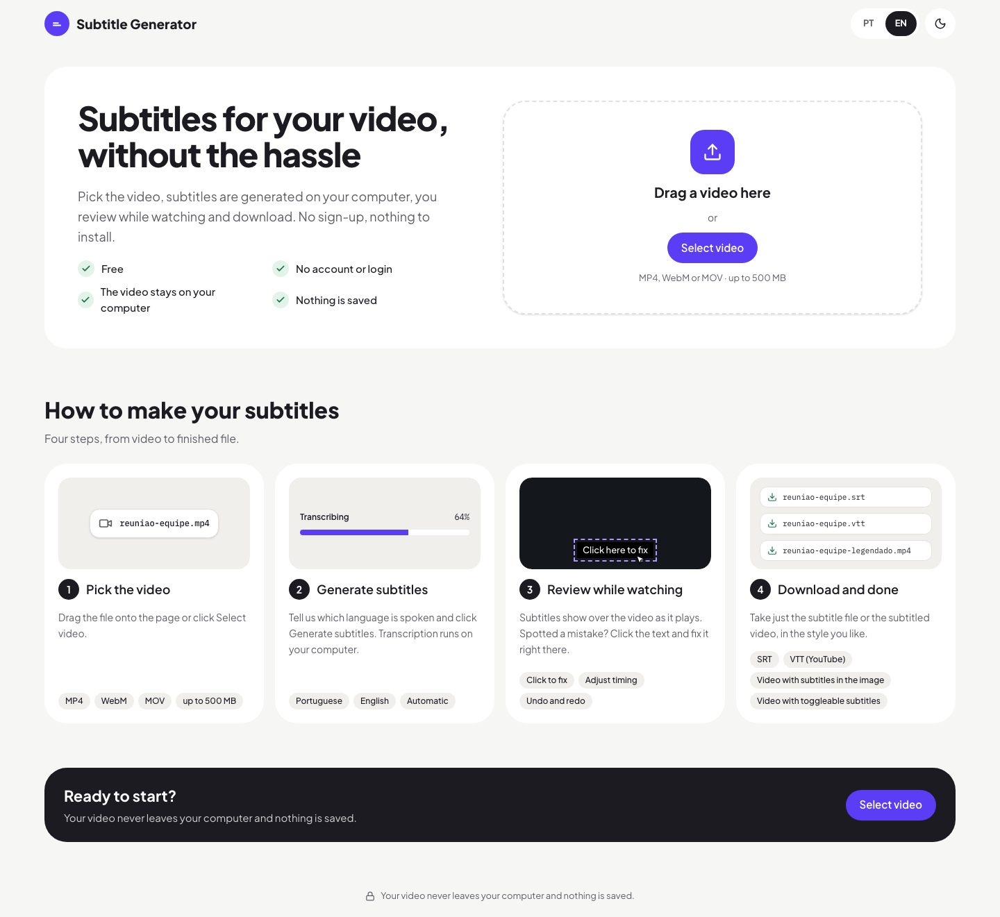
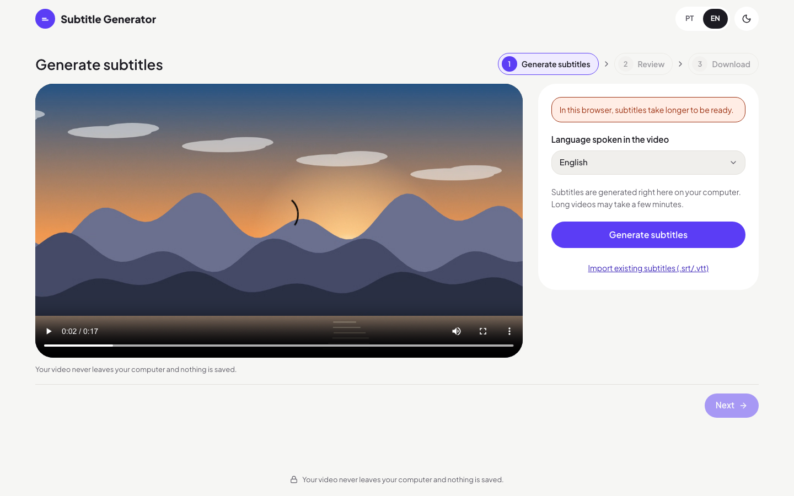
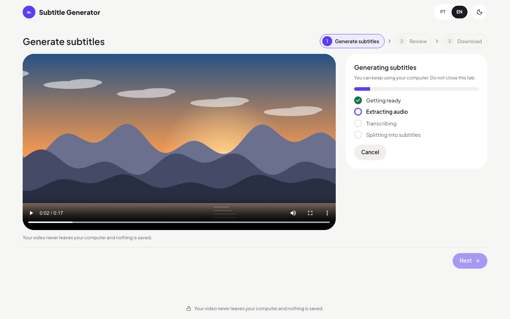
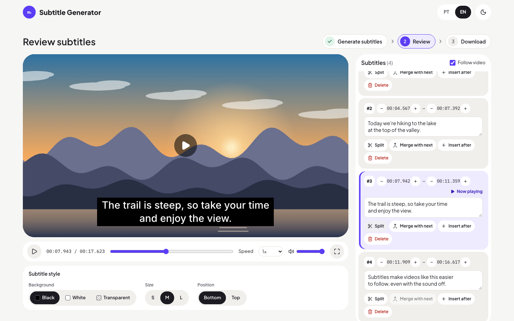
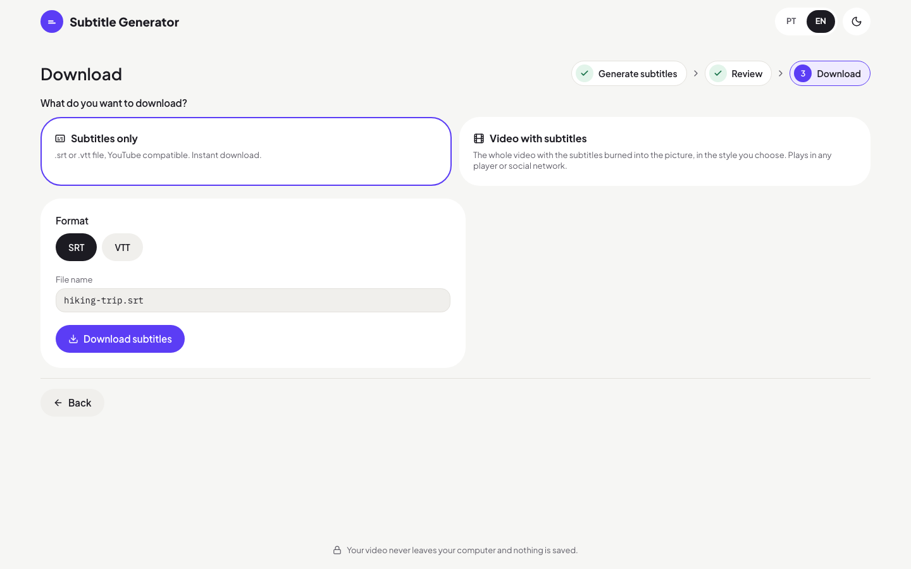
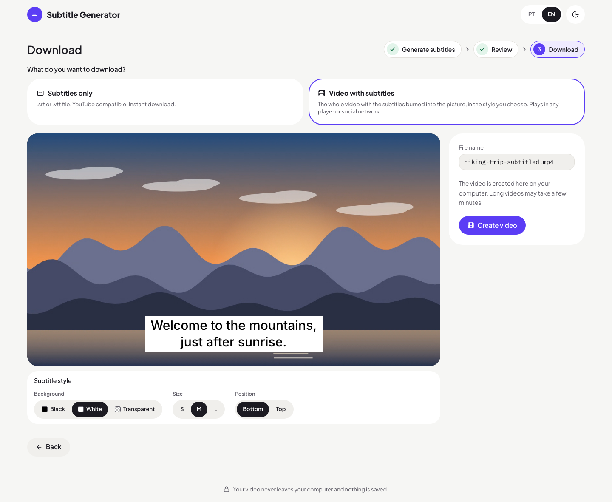
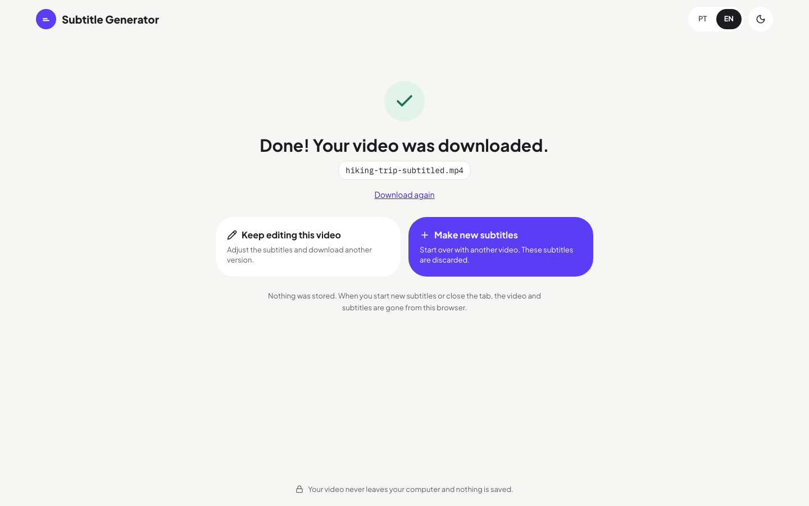

# Subtitle Generator

Free web app that creates subtitles for a video right in the browser. Pick a video, it is transcribed on your own computer with Whisper, you review the subtitles while watching, and you download an SRT/VTT file or the whole video with the subtitles burned in.

There is no backend, no account and no history. The video never leaves your computer and nothing is stored.



## How it works

### 1. Generate subtitles

Choose the language spoken in the video and click **Generate subtitles**. You can also import an existing `.srt` or `.vtt` file.



Transcription runs locally in a Web Worker. You can cancel at any time.



### 2. Review

The subtitles play over the video. Fix text on the video or in the list, adjust timing in 0.1 s steps, split, merge, insert or delete subtitles, and pick the subtitle style. The subtitle that matches the current time is marked **Now playing**.



### 3. Download

Download only the subtitles, as SRT or VTT:



Or create the whole video with the subtitles burned into the picture, in the style shown in the preview:



### Done

Download the same file again, go back to edit this video, or start over with another one.



## Under the hood

- **Transcription:** [Transformers.js](https://github.com/huggingface/transformers.js) runs Whisper in the browser. With WebGPU it uses `whisper-small`; without WebGPU it falls back to `whisper-base` on WebAssembly, which is slower. The model is downloaded once (a few hundred MB) and then cached by the browser.
- **Video:** [ffmpeg.wasm](https://github.com/ffmpegwasm/ffmpeg.wasm) extracts the audio and burns the subtitles into an H.264/AAC MP4. When the page is cross-origin isolated it uses the multi-threaded core.
- **Cross-origin isolation:** the app is served with `Cross-Origin-Opener-Policy: same-origin` and `Cross-Origin-Embedder-Policy: credentialless`. Multi-threaded ffmpeg needs both headers.
- **Stack:** Vite, React 19, TypeScript (strict), TanStack Router, Tailwind CSS v4, shadcn/ui, Zustand, i18next (Portuguese and English), Zod.

## Requirements

- Node 24 (see `.nvmrc`; 22.12 at minimum). Use the npm 11 that ships with Node 24. npm 10.9 fails when installing new packages with optional peer dependencies (`Cannot read properties of null (reading 'edgesOut')`).
- A recent Chrome or Edge for development (WebGPU and `crossOriginIsolated`).

## Run locally

```bash
npm ci
npm run dev
```

Open `http://localhost:5173` in Chrome or Edge.

## Scripts

| Command                           | What it does                                                     |
| --------------------------------- | ---------------------------------------------------------------- |
| `npm run dev`                     | Dev server at `http://localhost:5173`, with COOP/COEP            |
| `npm run build`                   | Typecheck and static build in `dist/` (includes `_headers`)      |
| `npm run preview`                 | Serves the build at `http://localhost:4173`, with COOP/COEP      |
| `npm run check`                   | Typecheck, lint, formatting and unit tests                       |
| `npm test`                        | Unit and component tests (Vitest and Testing Library)            |
| `npm run test:tooling`            | Tooling tests (tsc, ESLint, Prettier, build, CI)                 |
| `npm run test:e2e`                | End-to-end tests (Playwright) against the dev server and a build |
| `npm run lint` / `npm run format` | ESLint / Prettier                                                |

Install the e2e browser once with `npx playwright install chromium`. The e2e tests use a fake transcriber and a fake video exporter. Two optional suites use the real ones:

- `RUN_REAL_MODEL=1 npx playwright test` runs real Whisper (downloads the model).
- `RUN_REAL_FFMPEG=1 npx playwright test` runs real ffmpeg.wasm and checks that the subtitles are drawn in the exported video.

## Development workflow

The project follows spec-driven development with [OpenSpec](https://github.com/Fission-AI/OpenSpec). No code is written without an approved change.

1. `openspec new change <name>` creates `openspec/changes/<name>/` with a proposal, design, tasks and spec deltas.
2. `openspec validate <name> --strict` must pass.
3. The proposal is approved by a person.
4. The tasks are implemented. Every spec scenario has a test that cites the scenario name.
5. `openspec archive <name>` moves the change to `openspec/changes/archive/` and updates `openspec/specs/`.

The current behavior of the app is described in `openspec/specs/`. Specs are written in Portuguese, with normative keywords (SHALL, MUST) in English. The project context (stack, principles, product decisions) is in `openspec/config.yaml`.

## Hosting

Live at **https://subtitle-generator-cdi.pages.dev**, on Cloudflare Pages (free plan). The build is a static site with no server code:

- `public/_headers` sets COOP/COEP for every path. `config/cross-origin-headers.ts` sets the same headers for the dev server and the preview.
- `wrangler.jsonc` points Pages at `dist/`. Without a `404.html`, Pages serves `index.html` for app routes such as `/edit`.
- Large runtimes are not part of the build. The ffmpeg core and the ONNX Runtime `.wasm` used by Whisper load from jsDelivr at pinned versions, and the Whisper models load from Hugging Face. Cloudflare limits each file to 25 MiB.

Deploy with `npm run deploy`, which builds and runs `wrangler pages deploy`. It needs a one-time `npx wrangler login`.

Cloudflare now suggests Workers with static assets for new projects. This app stays on Pages because Hugging Face rejects model downloads from pages served on `*.workers.dev`.

## License

Proprietary. All rights reserved. This repository is public for reference only: copying, modifying, distributing or using the code requires written permission. See [LICENSE](LICENSE). Third-party components (the Inter font and the npm dependencies) keep their own licenses.
